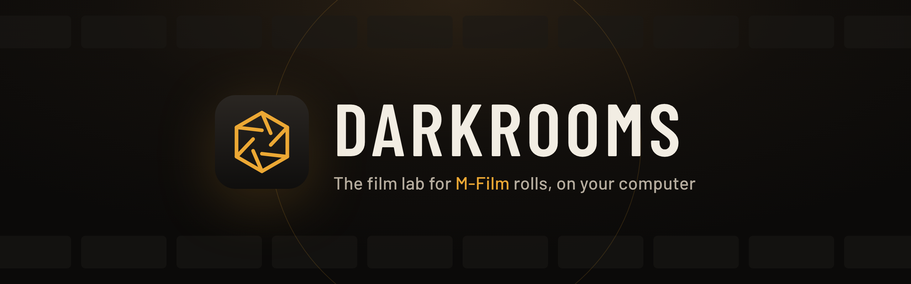
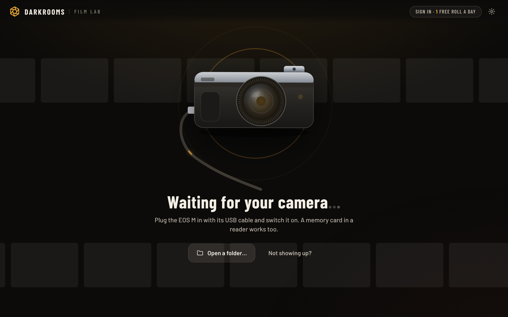

  

  
  
  

<h3 align="center">
  <a href="../../releases/latest">⬇&nbsp; Download Darkrooms</a>
</h3>

  Plug in the camera, pick a roll, and watch it develop. 
  Every pixel of the RAW, in the very colours the camera gives it.

 

  

 

## What it does

[M-Film](https://github.com/HNGSeries/mfilm-canon-film-simulation) turns a Canon camera that runs Magic Lantern into
a film camera: load a roll, shoot it, develop it. The camera can develop a roll by itself, slowly and at a smaller size.
Darkrooms does it on your computer, fast and at full size.

- **Every roll, found by itself.** Plug the camera in with its USB cable, or put its card in a reader. Darkrooms lists each roll: its film and its frames.
- **Full resolution.** Each frame is developed from the whole RAW: 5184 × 3456 on an 18 MP camera, every pixel.
- **The camera's own colours.** Darkrooms develops as the camera's darkroom does and reads the same colour tables, so a roll comes out the same in both. 68 film stocks.
- **Prints, filed like a lab would.** One folder per roll, named as the camera names it (`Sep0906 Portra400`), with a contact sheet.
- **Keeps itself up to date.** When a new version is out it says so, shows what's new, and installs it with one click.
- **Private.** Your pictures never leave your computer.

## Download

Get the newest build from **[Releases](../../releases/latest)**. Pick the file for your computer:

| Your computer | File | How to open it |
|---|---|---|
| **Windows 10 / 11** | `Darkrooms-windows-x64.zip` | Unzip, open the `Darkrooms` folder, run `Darkrooms.exe` (the orange icon: Windows often shows it as just `Darkrooms`, without `.exe`). |
| **Mac with Apple silicon** (M1 and later) | `Darkrooms-macos-apple-silicon.zip` | Unzip, drag `Darkrooms.app` to Applications and open it. |
| **Mac with Intel** | `Darkrooms-macos-intel.zip` | Same. |

About 45 MB for Windows and 30 MB for a Mac.

**The first time it opens.** Darkrooms isn't signed with Microsoft or Apple yet, so your computer asks first.
**Windows:** *More info* → *Run anyway*. **Mac:** *System Settings → Privacy & Security*, scroll down, *Open Anyway*
(macOS 14 and older: right-click the app → *Open*); if it still won't open,
`xattr -dr com.apple.quarantine "/Applications/Darkrooms.app"`. Windows Security has called Darkrooms 0.1.1 a trojan
(`Trojan:Win32/Bearfoos.B!ml`), a guess of its machine-learning model that has been reported to Microsoft as wrong ([M-Film#152](https://github.com/HNGSeries/mfilm-canon-film-simulation/issues/152)).

**It updates itself.** When a new version is out it says so at the top, shows what's new, and installs it with one
click. Keep it somewhere you can write to (on a Mac, in Applications).

## Free, or Full

| | Free | Darkrooms Full |
|---|---|---|
| Rolls a day | 1, of up to 36 frames (the same roll again that day doesn't count) | as many as you like |
| Every film, full size, EXIF, contact sheets | ✓ | ✓ |
| *Fast*: every core at once | | ✓ |
| Price | free, with a Google account | **US$2.99 a month** or **US$14.99 once** (checkout shows your currency), updates included |

The camera's own darkroom stays free and unlimited. Darkrooms goes with your **Google account**: no key to type in or keep.
Click the badge at the top right → *Sign in with Google*, then *Get it monthly* or *Get it for life*. After you pay,
Darkrooms switches to Full by itself within a few seconds. One Google account works on **two computers** at a time, Free or Full
(sign in on the other one with the same account). Cancel the monthly plan any time in the program
(*Manage the subscription*): it stays on until the end of the month paid for.
[Privacy](https://darkrooms-licence.suphalapruksasathit.workers.dev/privacy): your pictures never leave your computer.

## Help

- **The camera's files** (what goes on the card) are on **[M-Film's releases](https://github.com/HNGSeries/mfilm-canon-film-simulation/releases/latest)**, not here.
- **Something wrong?** [Open an issue](../../issues), and say which computer and which version of Darkrooms.
- **How the darkroom develops:** [M-Film's notes](https://github.com/HNGSeries/mfilm-canon-film-simulation/blob/main/ml-dev/DEVELOPING.md).

 

  This repository holds Darkrooms' builds and release notes only. 
  Darkrooms 0.2.1 and older were published in <a href="https://github.com/HNGSeries/mfilm-canon-film-simulation/releases?q=Darkrooms&expanded=true">M-Film's releases</a>, and 0.2.2 went there as well, so those versions find their update.

